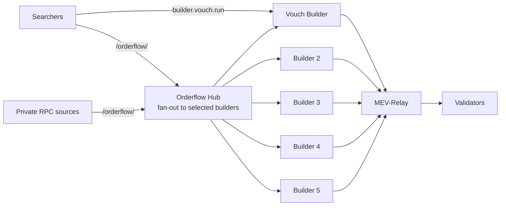

# Orderflow Hub

The **Orderflow Hub** takes one signed bundle and delivers it to every builder your profile selects,
so a single submission competes across the builder set instead of at one builder only.

There are two ways to submit, and they are independent:

| Endpoint | Gate | Goes to |
|---|---|---|
| `POST https://builder.vouch.run` | searcher allowlist | the **Vouch Builder** only |
| `POST https://builder.vouch.run/orderflow/` | hub allowlist | every builder your profile selects |

Both speak the same JSON-RPC method and the same Flashbots signature scheme. If you stay on
`builder.vouch.run` nothing changes for you; opting in to the hub means adding the `/orderflow/`
path.

::: tip Two audiences
This page covers both sides of the hub. Searchers: [opt in](#for-searchers) with one URL change.
Builders: [receive orderflow](#for-builders) by exchanging one endpoint and one signer address.
:::

## How it fits the stack



The hub is a distribution layer, not a relay: builders still bid through the
[MEV-Relay](./mev_relay) and validators still receive through [MEV-Boost](./mev_boost). No relay or
builder changes are required.

## For searchers

### Opting in

Change the endpoint from `https://builder.vouch.run` to
`https://builder.vouch.run/orderflow/`. Everything else — method, payload, signature — stays the
same. You can keep using the direct endpoint instead; the two are separate allowlists.

### Request

`eth_sendBundle`, JSON-RPC 2.0, one request object (no batches).

```json
{
  "jsonrpc": "2.0",
  "id": 1,
  "method": "eth_sendBundle",
  "params": [{
    "txs": ["0x..."],
    "blockNumber": "0x1A2B3C",
    "minTimestamp": 0,
    "maxTimestamp": 0,
    "revertingTxHashes": []
  }]
}
```

| Field | Notes |
|---|---|
| `txs` | 1–64 signed transactions; combined ≤ 192 KiB. |
| `blockNumber` | **Required**, 0x-hex, an absolute **future** block. A target at or behind the current head is rejected before the bundle is stored. |
| `minTimestamp` / `maxTimestamp` | Optional validity window (0 = no bound). |
| `revertingTxHashes` | Optional; transactions allowed to revert without invalidating the bundle. |

There are no per-bundle protection, builder or horizon fields on this endpoint.

### Response

```json
{
  "jsonrpc": "2.0",
  "id": 1,
  "result": {
    "bundleHash": "0x...",
    "jobId": "0x...",
    "targetBlock": 28104202,
    "acceptedBy": ["0x..."],
    "rejectedBy": [],
    "unreachable": [],
    "status": "accepted"
  }
}
```

- `targetBlock` and every block number in a response is a **decimal integer**.
- `acceptedBy` — builders that answered 2xx.
- `rejectedBy` — builders that answered 4xx.
- `unreachable` — timeout, transport error, circuit open, 5xx, or a builder no longer enabled.
- `status` — `accepted` (at least one builder took it), `rejected` (no accepts, at least one
  clean 4xx rejection) or `unreachable` (no accepts and no clean rejections).

**HTTP 200** means at least one builder accepted the bundle for your target block. It is not an
inclusion guarantee — the bundle still has to simulate cleanly and win the block.

**HTTP 502** means no builder accepted it. The body is JSON-RPC error `-32006` with the same fields
under `error.data`, so you still see which builders rejected and which were unreachable.

### Timing, retries and replay

- Your `blockNumber` is the target: the hub does not rewrite it.
- The hub dispatches immediately and in parallel to every selected builder, with a **800 ms
  per-builder bound**. The response waits at most that long; with more targets than the dispatch
  pool, a raw-transaction-only builder, or a slow head lookup, a response can take slightly longer.
- Searcher bundles are tried for the target block by default (**1 block**). A two-block horizon is
  available per searcher by arrangement.
- The same signed body is accepted once. A retry of an identical body after at least one builder
  accepted returns `409` (`-32002`). If the earlier attempt got **no** accepts and the job is still
  open, the same body is re-dispatched and returns a fresh result.
- A searcher bundle is never broadcast to the public mempool.

### Limits

| Limit | Value |
|---|---|
| Request body | 256 KiB |
| Transactions per bundle | 64 |
| Combined transaction bytes | 192 KiB |
| Per-source rate | 2 requests/s sustained, burst 10 (ask us for more) |
| Per-IP rate at the edge | 30 requests per 2 s |
| Duplicate body | `409` for the life of the job (7-day retention); a zero-accept retry is re-dispatched while the job is open |

### Error codes

| Code | HTTP | Meaning |
|---|---|---|
| `-32600` | 200 | Invalid JSON-RPC request (batches are rejected) |
| `-32601` | 200 | Method not found |
| `-32602` | 200 | Invalid params, including a target block that is not in the future |
| `-32001` | 401 | Authentication failed (bad signature or address not allowlisted) |
| `-32002` | 409 | Duplicate submission |
| `-32003` | 429 | Per-source quota exceeded |
| `-32005` | 503 | Storage unavailable — retry with backoff |
| `-32006` | 502 | No builder accepted the bundle (`error.data` carries the result) |

::: warning Privacy
Fan-out is the product: every selected builder sees the bundle, can simulate it, and may act on what
it learns. There is no encryption, TEE or watermarking in this version. Searchers opt in to that
trade-off in exchange for reaching more of the builder set.
:::

### Searcher onboarding

1. Send your signing address to the Vouch team (see [Support](#support)). Include a signature from
   that key over a sample body if you have one ready.
2. We add it to the hub allowlist with your builder selection.
3. Once allowlisted, submit to `/orderflow/` — no other change.

### Support

- [Telegram](https://t.me/VouchVals)
- [Docs home](https://vouch.run/docs/)

## For builders

### What you receive

Once enabled, the hub delivers orderflow to your ingest endpoint using `eth_sendBundle`:

- **Authentication:** the hub signs each request with its own Flashbots key
  (`X-Flashbots-Signature`). We send you the signer address during onboarding; allowlist it.
- **Per block:** deliveries are made for each block of a job's window, not once. Private user
  transactions are retried every block for up to **24 blocks**; searcher bundles for **1 block**
  (2 by arrangement).
- **`signingAddress`:** the outbound params carry the originating source's address, so you can
  attribute what you receive per source.
- **Your answer matters:** a 2xx makes you `acceptedBy` in the source's response; a 4xx makes you
  `rejectedBy`; a timeout or 5xx makes you `unreachable`.
- **No relay change:** you still bid through the [MEV-Relay](./mev_relay) as before.

### Builder onboarding

1. Contact the Vouch team and exchange the connection details below.
2. Add our signer address to your ingest allowlist (we provide it in EIP-55 and lowercase).
3. We enable your entry in the builder directory and send a test job.
4. Verify the delivery and its attribution, then go live.

### What we need from you

| Item | Notes |
|---|---|
| Ingest URL | `https://…` endpoint that accepts `eth_sendBundle` |
| Accepted methods | `eth_sendBundle`, `eth_sendRawTransaction`, or both |
| Auth scheme | Flashbots signature (preferred) or a bearer token |
| Our signer allowlisted | Address in EIP-55 **and** lowercase |
| Rate/latency limits | Requests per second, timeout, any minimum bundle value |
| Contact | Who to reach for incidents and changes |

## Commercial terms

The hub is **free and best-effort** in this version. There is no SLA. Limits and timeouts on this
page are current operational values and may change with notice.

## Support

- [Telegram](https://t.me/VouchVals)
- [Docs home](https://vouch.run/docs/)
